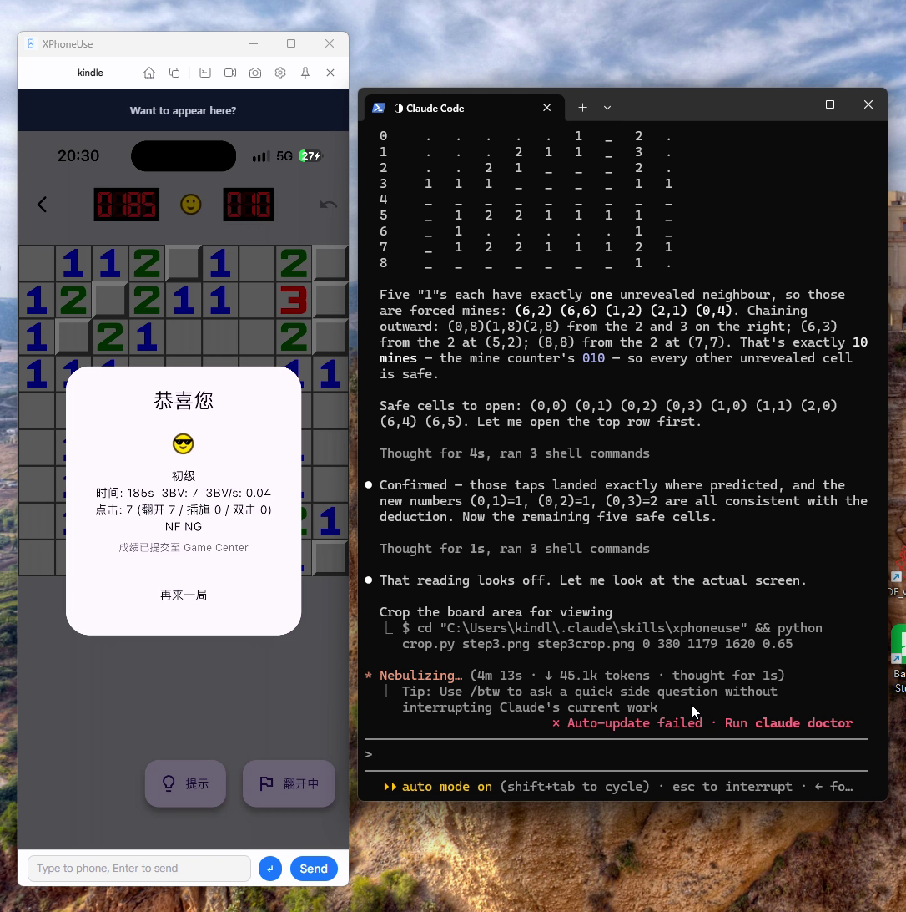

# XPhoneUse

**Unlock the agentic world on your phone.**

XPhoneUse mirrors a real phone to your computer and hands it to an agent —
Android and iPhone alike, on Windows, macOS and Linux.

Driving an iPhone needs no Xcode, no Apple developer account and no XCTest:
plug in the cable and tap Trust once. From there, MCP, the CLI and the skill put
the phone inside Claude, Codex, WorkBuddy or any other agent.

*Free · No account · Everything stays on your machine.*



English | [简体中文](README.zh-CN.md)

**Website:** <https://xphoneuse.com> — guides, screenshots and more examples.

---

## Why XPhoneUse

- **A real phone, not an emulator** — real device, real accounts, real app
  state; nothing to sideload and nothing that looks synthetic.
- **Built for agents** — an MCP server runs inside the app, next to a CLI and an
  agent skill, so tapping, typing, scrolling and screenshotting are one tool
  call away.
- **Three desktops, one experience** — native installers for Windows, macOS and
  Linux (exe, dmg, deb, AppImage). Android over scrcpy, iPhone over the USB
  tunnel.
- **No Xcode for iPhone** — plug in, unlock, tap Trust. The app reveals the
  Developer Mode switch and installs the developer image itself.
- **Screenshots, recording, macros, files** — capture, record, replay, and move
  files in both directions, plus map-driven location simulation.
- **Nothing leaves your machine** — the MCP endpoint listens on
  `127.0.0.1:7070` only, over USB or your own LAN; no relay, no account, no
  record of what you do on the phone.

## Features

- **Live mirror** — Android through scrcpy (H.264 over ADB); iPhone through the
  CoreDevice USB tunnel (RTP/H.264) on iOS 17+, with AirPlay as a fallback.
  Decoded with WebCodecs and drawn to a canvas; the window sizes itself to the
  device.
- **Real input** — tap, long-press, swipe, scroll, hardware buttons, keyboard
  and text. Non-ASCII text goes through the device clipboard (paste + Cmd+V) or
  the AgentInput keyboard on iOS.
- **Screenshots and recording** — JPEG/PNG screenshots (also exposed to agents)
  and WebM screen recording.
- **Macros** — record a session, replay it, loop it.
- **File manager** — a separate window that browses the phone, uploads and
  downloads; drag files in from the desktop and out to it. On iOS this is the
  media area (AFC), which needs no developer image.
- **Location simulation** — pick a point on a map and move the phone there
  (GCJ-02 ↔ WGS-84 handled).
- **Copilot** — OCR the current screen and draft a reply (offline OCR, optional
  AI backend).
- **MCP server** — embedded in the app at `http://127.0.0.1:7070/mcp`, so
  Claude/other agents can list devices, connect, tap, type, screenshot, OCR,
  move files and more. A ready-made agent skill lives in `skills/xphoneuse`.
- **CLI** — Python (zero dependencies) and Rust clients for the same MCP tools.
- **Android extras** — multiple devices, ADB over Wi-Fi, UI hierarchy queries.
- **Desktop extras** — auto-update, start on login, light/dark theme,
  English/Chinese UI.

## Supported devices

| Phone | Mirror | Input | Notes |
|---|---|---|---|
| Android (USB / Wi-Fi ADB) | ✅ scrcpy | ✅ | Any device with USB debugging |
| iPhone, iOS 17+ | ✅ CoreDevice USB tunnel | ✅ | Developer Mode on; the app installs a developer disk image automatically |
| iPhone, iOS 16 and older | ✅ AirPlay (uxplay) | ◐ BLE-HID bridge | Input needs the AC636N USB-CDC bridge; without it the session is view-only |

Hosts: **Windows 10/11**, **macOS**, **Linux** (X11 or Wayland).

> iOS notes: installing the developer image requires **Developer Mode** and a
> **trusted, unlocked** phone. XPhoneUse can reveal the switch and, on request,
> enable it (which reboots the phone). The developer image itself is downloaded
> from a public mirror and personalized for the device (a personalized DDI for
> older hardware, a Cryptex for the iPhone 18 series and newer). See
> [docs/IOS.md](docs/IOS.md) for the iPhone transport details.

## Architecture

```
┌──────────────────────────── desktop app (Tauri 2) ───────────────────────────┐
│  React + TypeScript (Vite)          Rust host (src-tauri)                    │
│  · mirror canvas (WebCodecs)  ◀── Annex-B access units ──  xphoneuse-ios    │
│  · file manager window        ◀── frames / events ───────  xphoneuse-core   │
│  · settings, i18n, updater                     │                             │
│                                                ├── embedded MCP (rmcp)       │
│                                                │      ▲ HTTP 127.0.0.1:7070  │
└────────────────────────────────────────────────┼──────────────────────────────┘
                                                 │
                             agents / Python CLI / Rust CLI
```

| Path | What it is |
|---|---|
| `src-tauri/` | The desktop app: commands, windows, tray, MCP wiring, updater |
| `src/` | React frontend: mirror, file manager, settings, i18n |
| `crates/xphoneuse-core` | Shared device layer: adb/scrcpy, files, macros, location |
| `crates/xphoneuse-ios` | iOS: CoreDevice tunnel, RTP depacketizing, HID, screenshots, pasteboard, AFC, developer images, AirPlay FFI, BLE bridge |
| `crates/xphoneuse-mcp` | MCP tools and the HTTP server |
| `crates/xphoneuse-ocr` | Offline OCR (MNN) |
| `crates/xphoneuse-copilot` | Screen → reply copilot |
| `crates/xphoneuse-cli` | Standalone Rust CLI (its own workspace) |
| `vendor/idevice` | Vendored [idevice](https://github.com/jkcoxson/idevice) fork (MIT) |
| `vendor/uxplay` | Vendored UxPlay fork with GStreamer removed (GPL-3.0) |
| `skills/xphoneuse` | Agent skill (`SKILL.md`, `APP-IDS.md`) + Python CLI |

## Building from source

### Prerequisites

- **Rust** (stable) and **cargo**
- **Bun** (`bun --version`) — the frontend and the release script
- **CMake + Ninja** — the OCR engine (MNN) is compiled from source on Windows
- Platform toolchain:
  - **Windows**: Visual Studio 2022 Build Tools (Desktop C++), WebView2 (built
    into Windows 11), Git Bash (for `scripts/*.sh`)
  - **macOS**: Xcode Command Line Tools
  - **Linux**: `build-essential pkg-config libssl-dev libudev-dev
    libwebkit2gtk-4.1-dev libayatana-appindicator3-dev librsvg2-dev patchelf
    adb usbmuxd cmake ninja-build python3`

### Build

```sh
bun install --frozen-lockfile

# 1. Frontend (vite → dist/)
bun run build

# 2. The app. The frontend is embedded at compile time, so touch the crate
#    whenever dist/ changed:
touch src-tauri/src/lib.rs
cargo build -p XPhoneUse          # debug binary: src-tauri/target/debug/XPhoneUse
```

For a release build and an installer for the current platform:

```sh
scripts/release.sh --only-build   # NSIS / dmg / deb + AppImage, no upload
```

Tauri bundles can only be built on their own OS. A full release is assembled by
uploading each platform's artifacts into one draft release — see
[docs/RELEASE.md](docs/RELEASE.md).

### Develop

```sh
bun run tauri dev      # Vite on :1420 + the desktop app with hot reload
```

### Tests and checks

```sh
cargo test -p xphoneuse-ios
cargo test -p XPhoneUse --lib
bunx tsc --noEmit
```

Probes for hardware work live in `crates/xphoneuse-ios/examples/`, e.g.
`cargo run -p xphoneuse-ios --example tunnel_stream_probe`,
`… --example cryptex_probe`, `… --example build_version_probe`.

## Using the MCP server

Turn the server on in **Settings → MCP** (default port `7070`). Any MCP client
can connect to `http://127.0.0.1:7070/mcp`.

The Python CLI is the shortest way to try it (the desktop app must be running):

```sh
python skills/xphoneuse/scripts/xphoneuse-cli.py list
python skills/xphoneuse/scripts/xphoneuse-cli.py screenshot
python skills/xphoneuse/scripts/xphoneuse-cli.py tap 0.5 0.5
python skills/xphoneuse/scripts/xphoneuse-cli.py text "hello"
```

The skill in `skills/xphoneuse/SKILL.md` teaches an agent how to use these
tools; `skills/xphoneuse/APP-IDS.md` maps apps to bundle ids. A standalone Rust
build of the CLI lives in `crates/xphoneuse-cli`.

## Configuration

| Variable | Effect |
|---|---|
| `XPHONEUSE_DDI_BASE` | Override the developer-disk-image mirror (a URL or a local path) |
| `UART_HID_KEY` | AES key for the AC636N BLE-HID bridge (32 hex chars; the dev key is a placeholder — change it in production) |
| `UART_HID_PORT` | Pin the bridge's serial port, e.g. `COM10` |
| `XPHONEUSE_LOG_STDERR=1` | Keep logs on stderr in a packaged build |
| `XPHONEUSE_APTABASE_KEY` / `XPHONEUSE_APTABASE_HOST` | Build-time only: enable anonymous usage analytics. Without them no analytics code sends anything |

A fork must also replace the updater settings in `src-tauri/tauri.conf.json`
(`plugins.updater.endpoints` and `pubkey`) and the app slug in
`scripts/release.sh`, or its builds will look for updates at this
project's release server.

Logs: packaged builds write to a file only when **Settings → Save logs to a
file** is on (restart to apply); the file is
`<app data>/com.aovik.xphoneuse/xphoneuse.log`. Debug builds always log to
stderr.

## Privacy

Analytics are anonymous and off in a plain build. When enabled at build time,
connecting a phone reports the platform, model identifier and OS version — no
device names, serials, screen contents or typed text.

## License

The application is **MIT** (see [LICENSE](LICENSE)). Bundled third-party work:

- [idevice](https://github.com/jkcoxson/idevice) — MIT (`vendor/idevice`)
- [scrcpy](https://github.com/Genymobile/scrcpy) server — Apache-2.0
- Android SDK Platform-Tools (`adb`) — Apache-2.0
  (`src-tauri/resources/adb-NOTICE.txt`)
- [UxPlay](https://github.com/FDH2/UxPlay) fork — GPL-3.0
  (`vendor/uxplay`; the Windows/macOS builds link the AppImage/dmg to the
  prebuilt `uxplay` library)
- Google Sans is bundled for the UI (`src/assets/fonts`). It is Google's
  proprietary typeface — check its licensing terms before redistributing
  derived builds.

## Contributing

Issues and pull requests are welcome. Please keep the existing conventions:
conventional commit messages, `cargo test` + `bunx tsc --noEmit` green, and no
secrets in the tree (`tauri.key`, `*.env`, release credentials stay local).
