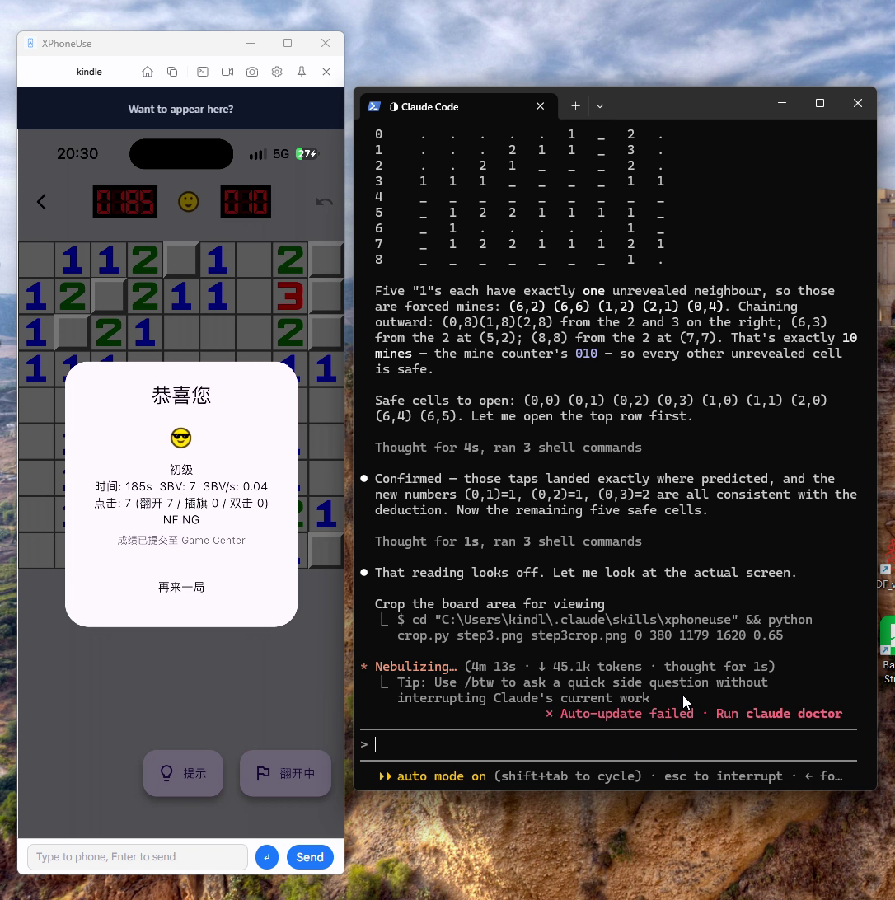

# XPhoneUse

**让你的手机接入智能体。**

XPhoneUse 把真机镜像到电脑，交给智能体去操作。Android 和 iPhone 都支持，
Windows、macOS、Linux 三个平台一样能用。

控制 iPhone 不需要 Xcode、不需要 Apple 开发者账号、也不需要 XCTest——插上线、
点一次「信任」就行。再通过 MCP、CLI、Skill 把这些能力接进 Claude、Codex、
WorkBuddy 等智能体。

*免费 · 无需注册 · 数据不离开你的电脑。*



[English](README.md) | 简体中文

**官网：** <https://xphoneuse.com> —— 更多示例、截图与使用教程都在这里。

---

## 为什么选 XPhoneUse

- **真机，不是模拟器**——真实设备、真实账号、真实应用状态，没有模拟器的限制。
- **为智能体而生**——应用内嵌 MCP 服务，并提供 CLI 与 Skill；点击、输入、滚动、
  截图都是一次工具调用。
- **三个桌面平台，一样的体验**——Windows、macOS、Linux 原生安装包（exe / dmg /
  deb / AppImage）；Android 用 scrcpy，iPhone 走 USB 隧道。
- **iPhone 不用 Xcode**——插线、解锁、点「信任」即可；开发者模式开关由应用揭示，
  开发者镜像由应用自动安装。
- **截图 · 录屏 · 宏 · 文件**——截图、录屏、宏回放、双向传文件，以及地图选点改定位。
- **数据不离开你的电脑**——MCP 只监听 `127.0.0.1:7070`，USB 或你自己的局域网直连，
  无中转、无账号、不记录你在手机上做什么。

## 功能

- **实时镜像**：Android 走 scrcpy（ADB 上的 H.264）；iPhone 在 iOS 17+ 走
  CoreDevice USB 隧道（RTP/H.264），AirPlay 作为回退。WebCodecs 解码后画到
  canvas，窗口按设备比例自动调整大小。
- **真实输入**：点按、长按、滑动、滚动、硬件按键、键盘与文本。非 ASCII 文本在
  iOS 上通过剪贴板（粘贴 + Cmd+V）或 AgentInput 键盘输入。
- **截图与录屏**：JPEG/PNG 截图（agent 也可调用）、WebM 录屏。
- **宏**：录制一段操作，回放、循环播放。
- **文件管理器**：独立窗口浏览手机文件，上传/下载；支持从桌面拖入、拖出。iOS
  打开的是媒体区（AFC，不需要开发者镜像）。
- **位置模拟**：在地图上选点，把手机移过去（已处理 GCJ-02 与 WGS-84 的互转）。
- **副驾**：离线 OCR 读取当前屏幕并起草回复（可选接 AI 后端）。
- **MCP 服务**：内嵌在应用里，`http://127.0.0.1:7070/mcp`。Claude 或其他 agent
  可以列设备、连接、点按、输入、截图、OCR、传文件等。随仓库附带现成的 agent
  skill（`skills/xphoneuse`）。
- **CLI**：Python（零依赖）与 Rust 两个客户端，调用的都是同一套 MCP 工具。
- **Android 额外能力**：多设备、Wi-Fi ADB、UI 层级查询。
- **桌面端能力**：自动更新、开机自启、明暗主题、中英文界面。

## 支持的设备

| 手机 | 镜像 | 输入 | 说明 |
|---|---|---|---|
| Android（USB / Wi-Fi ADB） | ✅ scrcpy | ✅ | 只要打开 USB 调试即可 |
| iPhone，iOS 17+ | ✅ CoreDevice USB 隧道 | ✅ | 需开启开发者模式；应用会自动安装开发者镜像 |
| iPhone，iOS 16 及更早 | ✅ AirPlay（uxplay） | ◐ 需 BLE-HID 桥 | 输入需要 AC636N USB-CDC 桥接器，没有就只能观看 |

宿主系统：**Windows 10/11**、**macOS**、**Linux**（X11 或 Wayland）。

> iOS 说明：安装开发者镜像需要**开发者模式**，手机需**解锁并信任电脑**。
> XPhoneUse 可以把「开发者模式」开关揭示出来，并在用户确认后远程打开（会重启
> 手机）。开发者镜像来自公开镜像源，并按设备做个性化签名——老机型用 personalized
> DDI，iPhone 18 系列及更新机型用 Cryptex。iPhone 传输层的细节见
> [docs/IOS.md](docs/IOS.md)。

## 架构

```
┌──────────────────────────── 桌面应用（Tauri 2） ─────────────────────────────┐
│  React + TypeScript（Vite）          Rust 宿主（src-tauri）                   │
│  · 镜像 canvas（WebCodecs）  ◀── Annex-B 访问单元 ──  xphoneuse-ios          │
│  · 文件管理器窗口            ◀── 帧 / 事件 ─────────  xphoneuse-core         │
│  · 设置、i18n、更新器                         │                              │
│                                               ├── 内嵌 MCP（rmcp）           │
│                                               │      ▲ HTTP 127.0.0.1:7070   │
└───────────────────────────────────────────────┼───────────────────────────────┘
                                                │
                              agent / Python CLI / Rust CLI
```

| 路径 | 作用 |
|---|---|
| `src-tauri/` | 桌面应用：命令、窗口、托盘、MCP 装配、更新器 |
| `src/` | React 前端：镜像、文件管理器、设置、i18n |
| `crates/xphoneuse-core` | 共享设备层：adb/scrcpy、文件、宏、位置 |
| `crates/xphoneuse-ios` | iOS：CoreDevice 隧道、RTP 拆包、HID、截图、剪贴板、AFC、开发者镜像、AirPlay FFI、BLE 桥 |
| `crates/xphoneuse-mcp` | MCP 工具与 HTTP 服务 |
| `crates/xphoneuse-ocr` | 离线 OCR（MNN） |
| `crates/xphoneuse-copilot` | 屏幕 → 回复的副驾 |
| `crates/xphoneuse-cli` | 独立的 Rust CLI（自带 workspace） |
| `vendor/idevice` | vendored 的 [idevice](https://github.com/jkcoxson/idevice) 分支（MIT） |
| `vendor/uxplay` | vendored 的 UxPlay 分支，移除了 GStreamer（GPL-3.0） |
| `skills/xphoneuse` | agent skill（`SKILL.md`、`APP-IDS.md`）与 Python CLI |

## 从源码构建

### 依赖

- **Rust**（stable）与 **cargo**
- **Bun**（`bun --version`）——前端与发布脚本都用它
- **CMake + Ninja**——OCR 引擎（MNN）在 Windows 上从源码编译
- 平台工具链：
  - **Windows**：Visual Studio 2022 Build Tools（Desktop C++）、WebView2
    （Windows 11 自带）、Git Bash（`scripts/*.sh` 需要）
  - **macOS**：Xcode Command Line Tools
  - **Linux**：`build-essential pkg-config libssl-dev libudev-dev
    libwebkit2gtk-4.1-dev libayatana-appindicator3-dev librsvg2-dev patchelf
    adb usbmuxd cmake ninja-build python3`

### 构建

```sh
bun install --frozen-lockfile

# 1. 前端（vite → dist/）
bun run build

# 2. 应用。前端在编译期嵌入二进制，dist/ 变了就要 touch 一下：
touch src-tauri/src/lib.rs
cargo build -p XPhoneUse          # 调试产物：src-tauri/target/debug/XPhoneUse
```

打当前平台的安装包（不上传）：

```sh
scripts/release.sh --only-build   # NSIS / dmg / deb + AppImage
```

Tauri 安装包只能在对应系统上构建；一次完整发布是各平台分别上传到同一个
draft 里拼起来的，详见 [docs/RELEASE.md](docs/RELEASE.md)。

### 开发

```sh
bun run tauri dev      # Vite（:1420）+ 桌面应用，热更新
```

### 测试与检查

```sh
cargo test -p xphoneuse-ios
cargo test -p XPhoneUse --lib
bunx tsc --noEmit
```

硬件相关的探针在 `crates/xphoneuse-ios/examples/`，例如：

```sh
cargo run -p xphoneuse-ios --example tunnel_stream_probe
cargo run -p xphoneuse-ios --example cryptex_probe
cargo run -p xphoneuse-ios --example build_version_probe
```

## 使用 MCP

在**设置 → MCP**里打开服务（默认端口 `7070`），任何 MCP 客户端连接
`http://127.0.0.1:7070/mcp` 即可。

想快速试一下，用 Python CLI 最方便（需要桌面应用在运行）：

```sh
python skills/xphoneuse/scripts/xphoneuse-cli.py list
python skills/xphoneuse/scripts/xphoneuse-cli.py screenshot
python skills/xphoneuse/scripts/xphoneuse-cli.py tap 0.5 0.5
python skills/xphoneuse/scripts/xphoneuse-cli.py text "你好"
```

`skills/xphoneuse/SKILL.md` 教 agent 怎么用这些工具，
`skills/xphoneuse/APP-IDS.md` 提供应用与 bundle id 的对照。Rust 版 CLI 在
`crates/xphoneuse-cli`。

## 配置

| 环境变量 | 作用 |
|---|---|
| `XPHONEUSE_DDI_BASE` | 覆盖开发者镜像的下载源（URL 或本地路径） |
| `UART_HID_KEY` | AC636N BLE-HID 桥的 AES 密钥（32 位十六进制；开发密钥是占位值，生产必须更换） |
| `UART_HID_PORT` | 固定桥接器的串口，例如 `COM10` |
| `XPHONEUSE_LOG_STDERR=1` | 打包版也把日志留在 stderr |
| `XPHONEUSE_APTABASE_KEY` / `XPHONEUSE_APTABASE_HOST` | 仅编译期：开启匿名使用统计。不设置则完全不上报 |

如果你 fork 了本项目，记得替换 `src-tauri/tauri.conf.json` 里的更新器配置
（`plugins.updater.endpoints` 与 `pubkey`）以及 `scripts/release.sh` 里的应用
标识，否则打出来的包会去本项目的发布服务器找更新。

日志：打包版只有打开**设置 → 保存日志到文件**（重启生效）才写文件，位置是
`<应用数据>/com.aovik.xphoneuse/xphoneuse.log`；调试版始终输出到 stderr。

## 隐私

统计是匿名的，默认构建里完全不启用。编译时开启后，连接手机只会上报平台、机型
标识和系统版本——不包括设备名、序列号、屏幕内容或输入的文字。

## 许可证

应用本体为 **MIT**（见 [LICENSE](LICENSE)）。随包分发的第三方组件：

- [idevice](https://github.com/jkcoxson/idevice) — MIT（`vendor/idevice`）
- [scrcpy](https://github.com/Genymobile/scrcpy) server — Apache-2.0
- Android SDK Platform-Tools（`adb`）— Apache-2.0
  （`src-tauri/resources/adb-NOTICE.txt`）
- [UxPlay](https://github.com/FDH2/UxPlay) 分支 — GPL-3.0（`vendor/uxplay`；
  Windows/macOS 构建链接预编译的 uxplay 库）
- 界面里随包分发了 Google Sans 字体（`src/assets/fonts`）。它是 Google 的专有
  字体，二次分发前请自行确认授权条款。

## 参与贡献

欢迎 issue 和 PR。请保持现有约定：conventional commit、`cargo test` 与
`bunx tsc --noEmit` 通过、不要把密钥带进仓库（`tauri.key`、`*.env`、发布凭据
一律留在本地）。
